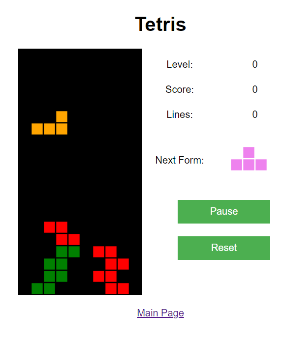

# Tetris Arcade 2026 - 4U.IA.BR

Plataforma moderna de **Tetris Arcade Retrô/Cyberpunk** para web e mobile.

  

## ✨ Recursos Implementados

1. **Jogabilidade Moderna**:
   - **7-Bag Randomizer**: distribuição justa das 7 peças sem repetições consecutivas injustas.
   - **Peça Fantasma (*Ghost Piece*)**: projeção de sombra translúcida indicando onde a peça vai pousar.
   - **Hard Drop (Queda Imediata)**: barra de espaço ou botão touch com efeito de impacto, screen shake e bônus de pontuação.
   - **Mecânica de Hold (Guardar Peça)**: tecla `C` ou `Shift` (ou botão de Hold) para reservar peças estrategicamente.
   - **SRS (Super Rotation System)**: rotações com compensação de parede (*wall kicks*).

2. **Áudio & Efeitos Sonoros (SFX)**:
   - Trilha sonora clássica oficial em MP3 com controle suave de mudo e retenção de estado.
   - Efeitos sonoros sintéticos em tempo real via **Web Audio API** (movimento, rotação, drop, hard drop, limpeza de linhas e fanfarra especial de TETRIS!).
   - Alternância de áudio em 3 modos: 🔊 Som & Música / 🎵 Apenas Efeitos / 🔇 Mudo.

3. **Responsividade & Controles Mobile**:
   - Controle virtual na tela (*D-Pad Touch* + botões ergonômicos de Hold, Giro e Hard Drop) para celulares e tablets.
   - Suporte a gestos touch na tela de jogo (*swipe* e *tap*).
   - Layout compacto sem rolagem vertical, ajustando-se a qualquer resolução (iPhone, Galaxy, telas UltraWide).

4. **Leaderboard / Ranking Persistente**:
   - Armazenamento em banco local **SQLite** (`data/scores.sqlite`) com fallback para LocalStorage.
   - Modal em tempo real com Top 10 maiores pontuadores (medalhas 🥇🥈🥉).
   - Registro instantâneo de pontuações via API REST assíncrona (`api/scores.php`).

5. **Visual Arcade Cyberpunk**:
   - Paleta escura com luzes de néon, gradientes e biselados nos blocos.
   - Sistema de partículas com explosão brilhante ao eliminar linhas.
   - Banners de notificação (*TETRIS!*, *NÍVEL X!*).
   - Rodapé padronizado **4U.IA.BR**.

## 🎮 Controles

| Ação | Teclado (Desktop) | Toque (Mobile) |
|---|---|---|
| Mover Esquerda / Direita | `◄` / `►` ou `A` / `D` | Botões `◄` e `►` ou deslizar |
| Girar Peça | `▲` / `W` / `X` | Botão `↻ GIRAR` ou toque |
| Girar Sentido Anti-Horário | `Z` | — |
| Descer Mais Rápido | `▼` ou `S` | Botão `▼` ou deslizar para baixo |
| Queda Imediata (*Hard Drop*) | `Espaço` | Botão `⤓ HARD DROP` |
| Guardar Peça (*Hold*) | `C` ou `Shift` | Botão `⇄ HOLD` |
| Pausar Jogo | `P` ou `Esc` | Botão `⏸` no topo |
| Alternar Áudio | `M` | Botão `🔊` no topo |
